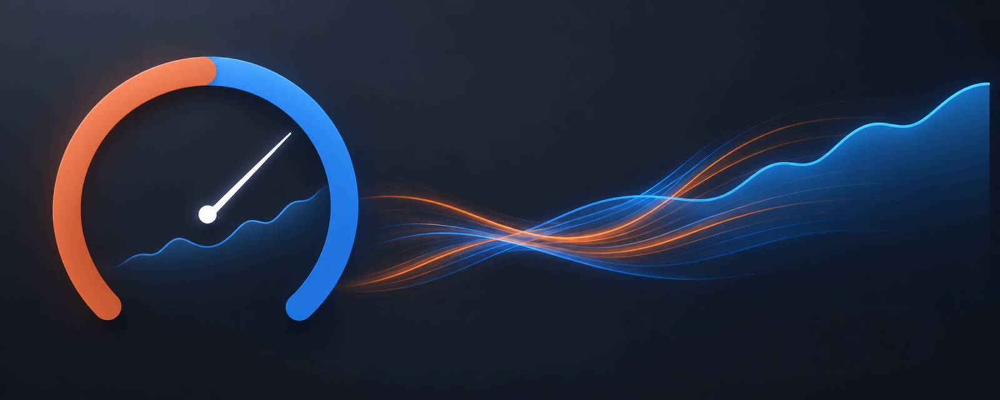
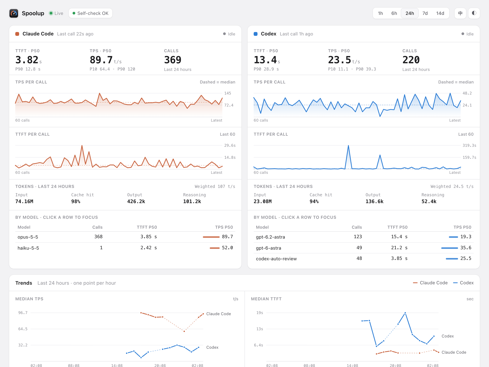
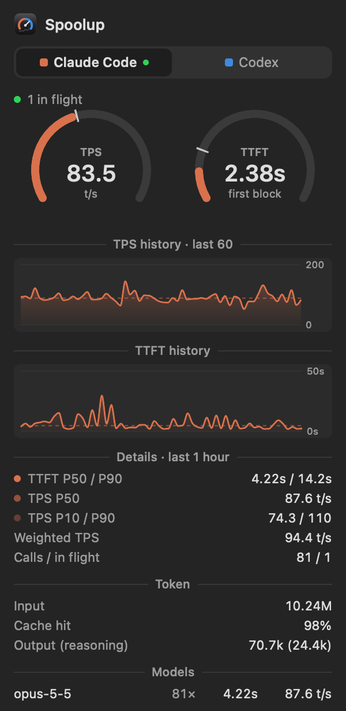

<p align="center"></p>

<h1 align="center"> Spoolup</h1>

<p align="center">
  <b>Time to first token and tokens per second for every Claude Code and Codex call,<br>read straight from the logs both tools already write.</b>
</p>

<p align="center">
  macOS menu bar app · Windows browser dashboard · no proxy · no extra requests · zero dependencies
</p>

<p align="center">
  <picture>
    <source media="(prefers-color-scheme: dark)" srcset="assets/screenshots/dashboard-dark.png">
    
  </picture>
</p>

> [!NOTE]
> Spoolup is an independent project, not affiliated with or endorsed by Anthropic or OpenAI. Claude Code and Codex are their respective owners' products. Spoolup relies on log formats neither tool documents, so an update to either tool can break it until the parsing rules are updated; the [self-checks](#self-checks) are there to tell you when that happens.

## Why

Coding agents feel fast one day and sluggish the next, but neither tool tells you how long a request waited for its first token or how quickly it streamed. Spoolup answers that for every call, without sitting in the network path:

- **Passive.** It tails the session logs that Claude Code and Codex write anyway. Nothing is proxied, re-sent or rate-limited, and your API keys are never touched.
- **Per call.** Every request is recorded separately, so you can see a slow call, a slow model or a slow afternoon.
- **Honest about its numbers.** The timings are inferred from log timestamps, so aggregates use medians and percentiles to absorb network jitter, and the collector keeps checking that its parsing rules still hold.

The name comes from turbochargers: a turbo has to spool up before it pulls. A model call works the same way: first the wait for the first token (TTFT), then the stream (TPS).

## Features



- **Menu bar app (macOS).** One icon in the menu bar; a dot shows a request in flight. Click it for a panel with TPS / TTFT gauges, history curves for the last 60 calls (hover to read any call, click to pin it), percentiles, token usage and a per-model breakdown. Switch between Claude Code and Codex with the toggle at the top or ⌘1 / ⌘2.
- **Full dashboard.** ⤢ opens a native window with both agents side by side, per-call charts, median TPS / TTFT trends, a per-project table and the full call list. Windows users get the same dashboard in the browser.
- **Focus on a model.** Click a row in an agent's *By model* table to switch that card, its charts and its trend line to that model.
- **Time windows.** 1 hour to 14 days.
- **English and Chinese.** One 中 / EN switch, shared by the panel and the dashboard.
- **Light and dark.** Follows the system, or pick one.
- **Self-checks.** If a tool update changes its log format, Spoolup tells you instead of quietly reporting wrong numbers (see [Self-checks](#self-checks)).

<br clear="right">

## Install

### macOS

Requirements: macOS 14 or later, [Node.js](https://nodejs.org) 22 or later, and the Xcode Command Line Tools (`xcode-select --install`) to build the app.

Clone or download this repository, then run:

```bash
./install.sh
```

This builds `~/Applications/Spoolup.app` and registers two LaunchAgents: the collector (always running) and the menu bar app (started at login). Run it without `sudo`. Run it again after pulling updates.

To remove everything:

```bash
./uninstall.sh
```

Your settings and logs in `~/.spoolup` are left in place; delete that folder too if you want a clean slate.

### Windows

Requirements: [Node.js](https://nodejs.org) 22 or later.

Double-click **`Spoolup.cmd`**. It starts the collector and opens the dashboard in your default browser once your logs are indexed. Double-click it again later to reopen the page. Spoolup runs while that console window stays open; to start it at login, put a shortcut to `Spoolup.cmd` in `shell:startup`.

> The Windows launcher has not yet been tested on a real Windows machine. Please open an issue if something doesn't work.

### npm (any platform)

With [Node.js](https://nodejs.org) 22 or later, run the collector and dashboard without cloning anything:

```bash
npx spoolup --open   # collector + dashboard on http://127.0.0.1:8787, opened in the browser
```

### Run by hand (any platform)

```bash
node server/spoolup.mjs          # collector + dashboard on http://127.0.0.1:8787
node server/spoolup.mjs --open   # same, and open the dashboard in the browser
```

On macOS you can also build and run the menu bar app directly:

```bash
swiftc -O -parse-as-library menubar/Spoolup.swift -o /tmp/Spoolup && /tmp/Spoolup
```

## How it works

Spoolup reads the logs both tools write to disk and pairs up the timestamps of each request with its response.

| | Logs | Request start | First token | End |
|---|---|---|---|---|
| **Claude Code** | `~/.claude/projects/**/*.jsonl` | `api-request` entry | first content block linked by `requestRef` | last content block |
| **Codex** | `~/.codex/sessions/**/rollout-*.jsonl` | latest user input or tool output | first output item; the first call of a turn uses Codex's own `time_to_first_token_ms` | `token_usage_record` |

From those, each call gets:

- **TTFT**: request sent → first content block written. Logs stamp each block when it *finishes*, so this is an upper bound on the true time to first token.
- **TPS**: output tokens (thinking / reasoning included) ÷ the whole call's duration, i.e. end-to-end throughput rather than raw generation speed.

Aggregates are medians and percentiles (P10 / P50 / P90), so a few calls hit by network jitter don't skew them. Calls with fewer than 50 output tokens are left out of TPS statistics, because a handful of tokens over a fixed overhead says little about speed.

## Self-checks

These rules depend on log formats that neither tool documents (verified on Claude Code 2.1.311 and Codex 0.169.0). The collector checks itself continuously over the last 24 hours of logs and sorts what it finds into two levels:

**Errors** mean the numbers are wrong or incomplete at scale. They show a red `!` on the menu bar icon, a system notification the first time they appear, and a banner in the panel and dashboard.

| Error | Trigger |
|---|---|
| Log line fails to parse | Any line in the last 24 hours that isn't valid JSON |
| Claude Code rules may be broken | At least 5 response blocks, fewer than 80% of them counted into calls |
| Claude Code log format not recognized | At least 20 log lines in the last hour, none matching any rule |
| Codex rules may be broken | At least 5 calls, usage records found for fewer than 80% of them |
| Too many estimated start times | More than 10% of Claude Code calls (at least 20) had to estimate when the request was sent |
| Collector problem | Internal error, log directory missing, or the app can't reach the collector |

**Records** are minor and stay quiet: no badge, no notification. They are listed, folded, under the dashboard header for when something looks off later. Examples: implausible values on a single call, a few estimated start times, requests that never got a response, Codex entries missing a field.

Both levels are also appended to `~/.spoolup/report.log` with the time, the affected file and the offending log line. In `/api/calls`, `ttft_source` shows where each call's TTFT came from, and Claude Code calls carry `estimated_start: true` when no `api-request` entry was found and the start time was estimated.

## Configuration

| Environment variable | Default | |
|---|---|---|
| `SPOOLUP_PORT` | `8787` | Port of the collector and dashboard |
| `SPOOLUP_HOST` | `127.0.0.1` | Address to listen on |
| `SPOOLUP_DAYS` | `14` | How many days of logs to index |
| `SPOOLUP_MIN_TPS_TOKENS` | `50` | Minimum output tokens for a call to count in TPS statistics |
| `SPOOLUP_POLL_MS` | `1500` | How often to check the logs for new lines |
| `CLAUDE_CONFIG_DIR` | `~/.claude` | Honored, as in Claude Code |
| `CODEX_HOME` | `~/.codex` | Honored, as in Codex |

On macOS, set these in the LaunchAgent plists that `install.sh` writes to `~/Library/LaunchAgents/`.

## Privacy

Everything stays on your machine. The collector only reads log files, listens on `127.0.0.1` by default, and makes no network requests of its own. It writes only to `~/.spoolup`:

| File | Contents |
|---|---|
| `server.log` | Collector output (macOS LaunchAgent) |
| `report.log` | Self-check errors and records |
| `prefs.json` | The shared language setting |

## HTTP API

The dashboard is a static page on top of a small JSON API, which you can also use directly.

| Endpoint | Returns |
|---|---|
| `GET /api/summary?window=3600` | Per-agent aggregates, recent calls, per-model and per-project stats, trend buckets and self-check status for the window (seconds) |
| `GET /api/calls?agent=claude&limit=200` | Individual calls, newest first (up to 5000) |
| `GET /api/health` | `status` (`ok` / `error`) and every self-check finding |
| `GET /api/events` | Server-sent events: `call` for each new or updated call, `prefs` when the language changes |
| `GET` / `POST /api/prefs` | Shared settings, currently `{"lang": "zh" \| "en"}` |

## Project layout

```
server/spoolup.mjs      collector, self-checks and HTTP API (Node.js, no dependencies)
server/dashboard.html   the dashboard (single file, no build step)
menubar/Spoolup.swift   macOS menu bar app (SwiftUI + AppKit, single file)
install.sh              macOS: build the app and register LaunchAgents
uninstall.sh            macOS: remove them
Spoolup.cmd             Windows launcher
package.json            npm package (`npx spoolup`)
assets/                 logo, app icon, banner and screenshots
LICENSE                 MIT
```

## Credits

The app icon and banner were generated with GPT image generation (the icon padded to the macOS icon grid); `assets/logo.svg` redraws the same mark as a vector for small sizes.

## License

[MIT](LICENSE) © 2026 Carbene
